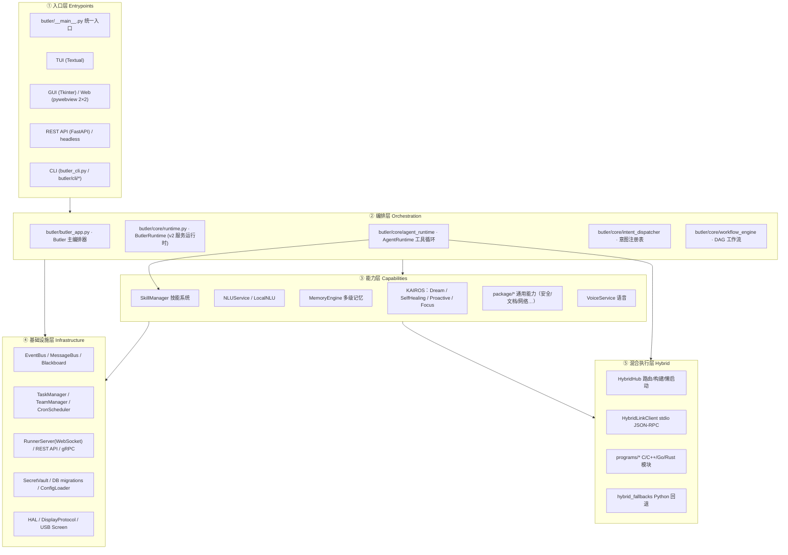
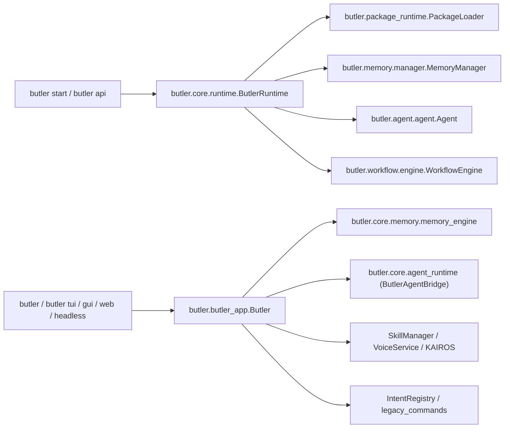
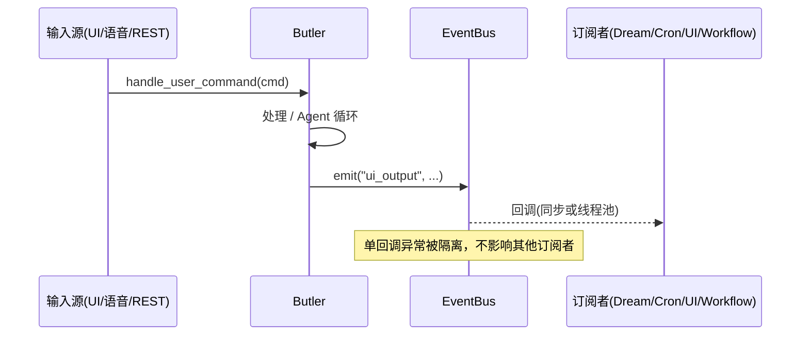

# 02 · 整体架构

## 2.1 分层视图

Butler 采用“入口层 → 编排层 → 能力层 → 基础设施层 → 混合执行层”的五层结构，自上而下依赖，自下而上被复用。



### 层职责一览

| 层 | 职责 | 代表模块 |
| :--- | :--- | :--- |
| 入口层 | 解析命令、选择运行模式、拉起对应 UI/服务 | `butler/__main__.py` |
| 编排层 | 初始化服务、路由用户输入、驱动 Agent 循环、编排工作流 | `butler_app.py`、`runtime.py`、`agent_runtime/` |
| 能力层 | 提供技能、NLU、记忆、语音、KAIROS、通用工具 | `skill_manager.py`、`nlu_service.py`、`memory_engine.py`、`package/` |
| 基础设施层 | 事件/消息、任务、定时、通信、密钥、配置、硬件抽象 | `event_bus.py`、`runner_server.py`、`secret_vault.py` |
| 混合执行层 | 跨语言高性能能力与回退 | `hybrid_hub.py`、`programs/*` |

## 2.2 两条并行的“主脑”路径

仓库里同时存在两套可运行形态，理解它们的关系是读懂架构的关键：



| 形态 | 入口 | 特点 | 主要记忆实现 |
| :--- | :--- | :--- | :--- |
| **桌面/终端主程序（功能最全）** | `butler`、`butler tui/gui/web/headless` | 完整服务栈：技能、语音、KAIROS、Runner、2×2 UI | `butler/core/memory/memory_engine.py`（Redis→Zvec→SQLite） |
| **v2 服务运行时（REST 优先）** | `butler start` / `butler api` | 轻量、面向 API 网关，`ButlerRuntime` 统一初始化 | `butler/memory/manager.py`（ShortTerm + SQLite LongTerm） |

> `butler.agent.agent.Agent`（`butler agent run` 使用）本身也复用 `AgentRuntime`，与桌面主程序共享同一套工具循环实现。

## 2.3 依赖注入：AppContainer

`Butler.__init__` 中相当一部分服务装配被统一到声明式容器，避免意图 handler 直接持有实例、降低耦合（部分基础服务仍在建容器前手动预创建）。

- 定义：`butler/core/container.py`
  - `ServiceSpec(factory, singleton=True, lazy=True)`：服务声明。
  - `AppContainer.resolve(name)`：按名解析；懒加载；检测循环依赖；缓存单例。
  - `resolve_all()`：按声明顺序实例化所有非懒服务。
  - `shutdown_all()`：**逆序**调用各实例的 `shutdown()`，保证依赖释放顺序。
- 装配：`butler/core/bootstrap.py` 的 `build_container(app, config_loader, prompts)` 注册约 20 个服务（`nlu_service`、`skill_manager`、`voice_service`、`workflow_engine`、`dream_engine`、`runner_server`、`secret_vault` 等）。

```python
# 简化示例：意图 handler 通过容器解析依赖
@register_intent("workflow_create", source="llm")
def handle_workflow_create(container, entities, **kwargs):
    wf_engine = container.resolve("workflow_engine")
    ...
```

设计收益：服务可被测试用 `container.override(name, fake)` 替换；生命周期可预测；新增服务只需注册一行。

## 2.4 进程内通信：事件驱动

Butler 几乎不直接“硬调用”后台组件，而是通过事件总线解耦：



- 全局单例 `event_bus`（`butler/core/event_bus.py`），保留最近 100 条事件历史。
- `emit()` 同步分发；`emit_async()` 在线程池中执行，适合耗时回调。
- 典型事件：`ui_output`、`voice_status`、`theme_change`、`cron:dream`、`cron:proactive-tick`、`workflow_execute`、`screenshot_update`。

## 2.5 启动时序（桌面主程序）

```mermaid
sequenceDiagram
    autonumber
    participant M as butler/__main__.py
    participant BA as butler_app.Butler
    participant CFG as ConfigLoader
    participant MEM as MemoryEngine
    participant SK as SkillManager
    participant AG as ButlerAgentBridge
    M->>BA: Butler(root, usb_screen, headless)
    BA->>BA: run_preflight_check() 环境预检
    BA->>BA: load_dotenv(); LogManager
    BA->>BA: HAL 硬件探测(失败→纯软件模式)
    BA->>CFG: 读取 config.yaml + ${ENV} 替换
    BA->>MEM: _initialize_long_memory() 三级降级
    BA->>SK: load_skills() + start_monitoring()
    BA->>BA: 初始化 KAIROS(Dream/Proactive/Focus/SelfHealing)
    BA->>BA: display_server.start(); cron_scheduler.start()
    BA->>BA: HybridLinkClient(sysutil).start()
    BA->>BA: SecretVault / RunnerServer / REST API 线程
    BA->>AG: 构建 AgentRuntime(工具+技能+权限+上下文)
    BA->>BA: _print_startup_banner()
    M->>BA: butler.main() (非阻塞) → UI 主循环
```

## 2.6 关键设计取舍

| 取舍 | 做法 | 影响 |
| :--- | :--- | :--- |
| 本地优先 | 记忆、密钥、技能、配置全部落本地；LLM 可指向 Ollama | 离线可用，隐私可控 |
| 优雅降级 | 依赖/硬件/向量库/语音缺失时逐级回退，不抛阻断错误 | 开箱即用，但需通过日志/`doctor` 观察真实能力 |
| 性能下沉 | 高并发/重计算/加解密交给 C/C++/Go/Rust | 更快，但需工具链；`via` 字段区分真实原生与回退 |
| 解耦 | 事件总线 + DI 容器 + 意图注册表 | 可测试、可扩展；也带来间接调用链，需借助本文索引定位 |

## 2.7 相关章节

- 入口细节：[03 入口与运行模式](./03-entrypoints.md)
- 主编排器逐方法详解：[04 核心编排器](./04-core-orchestrator.md)
- 服务清单与通信：[11 运行时服务与通信](./11-runtime-services.md)
- 依赖关系全图：[15 依赖关系](./15-dependencies.md)
