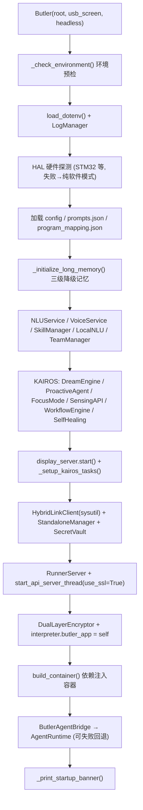
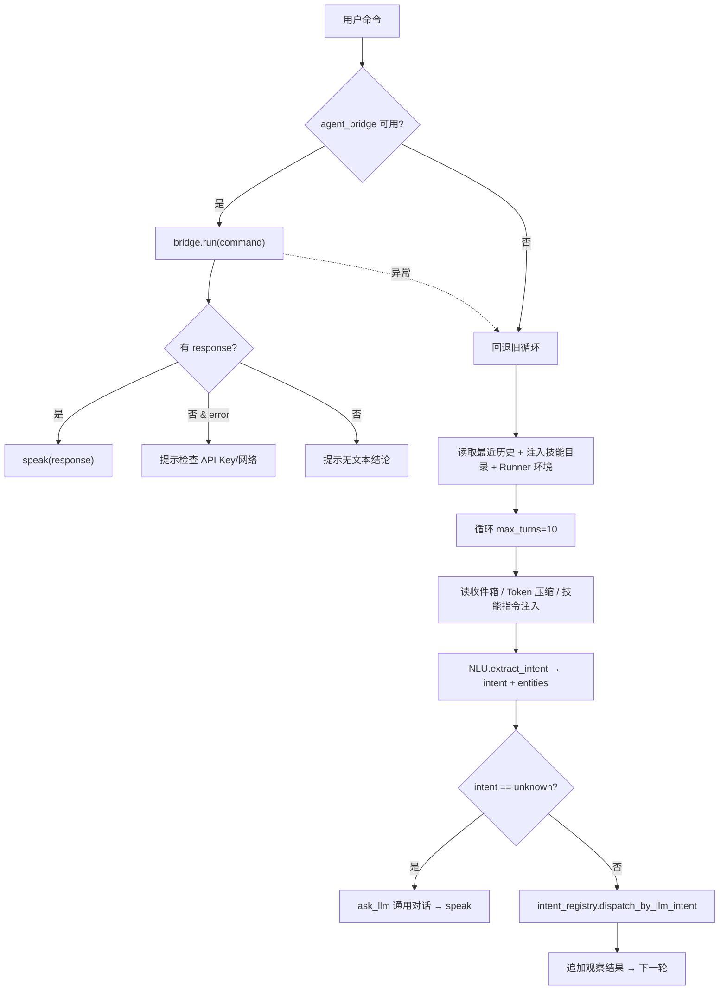

# 04 · 核心编排器：`Butler`

> 文件：`butler/butler_app.py`（约 6.4 万字节 / 1300+ 行）
> 职责：桌面主程序的总装车间与中枢调度器。它把配置、记忆、技能、语音、KAIROS、通信、Agent 等组件装配成可运行系统，并统一接收用户输入。

## 4.1 类职责：`class Butler`

`Butler` 是“门面（Facade）+ 装配器（Assembler）”。外部 UI（Tkinter / pywebview / TUI）只与它交互：
- UI → `handle_user_command(cmd)` → 编排内部能力 → `ui_print()/speak()` 回显。

## 4.2 初始化链（`__init__`）

按源码顺序，初始化可分为 10 个阶段：

### 分阶段要点

1. **Path 注入**：把项目根与 `lib_external/` 加进 `sys.path`，实现便携依赖。
2. **预检**：`butler.core.environment.run_preflight_check()` 在导入重型依赖前尽早执行。
3. **HAL 探测**：尝试 `package.device.stm32_hw_bridge.STM32HardwareBridge.find_node()`；失败即“纯软件管家模式”，不抛错。
4. **配置**：`config_loader._config`（Pydantic 校验后的 dict）+ `prompts.json` + `program_mapping.json`。
5. **记忆**：`_initialize_long_memory()` 依次尝试 Redis → Zvec → SQLite，再包成 `UnifiedMemoryEngine`（详见 [09 记忆系统](./09-memory.md)）。
6. **技能**：`SkillManager.load_skills()` + `start_monitoring()`（watchdog 热插拔）。
7. **KAIROS**：见 `_setup_kairos_tasks()`（下方）。
8. **通信/安全**：`RunnerServer` 注册 `_on_runner_event` 回调；REST API 以守护线程启动并默认启用自签名 SSL。
9. **DI 容器**：`build_container()` 注册所有服务，供意图 handler 通过 `container.resolve()` 取用。
10. **Agent 桥**：`ButlerAgentBridge(enabled=config.agent.runtime)`；构造失败则置 `agent_bridge=None`，旧意图循环兜底。

### `_setup_kairos_tasks()` 注册的定时任务

| 任务名 | 周期 | 订阅回调 |
| :--- | :--- | :--- |
| `dream` | 4 小时 | `DreamEngine.dream` |
| `proactive-tick` | 1 小时 | `ProactiveAgent.tick` |
| `timemachine_tick` | 30 秒 | `_record_system_snapshot` |
| `timemachine_cleanup` | 24 小时 | `_timemachine_cleanup(7)` |
| `workflow_execute`（事件） | 触发式 | `WorkflowEngine.execute_workflow` |

同时启动 `cluster_manager.start_discovery()`（局域网节点发现）与 `cron_scheduler.start()`。

## 4.3 关键方法说明

| 方法 | 作用 | 关键逻辑 |
| :--- | :--- | :--- |
| `handle_user_command(command, programs=None)` | 统一命令入口 | 活跃度更新 → 配额检查 → 记录日志 → 处理 UI 确认 → `/voice-mode`、`/skills`、`/skill`、`/py`、`/sh`、`/profile`、`/kairos`、`/performance`、`/encrypt` 等斜杠命令 → 否则进入 Agent 循环 |
| `ui_print(message, tag, response_id)` | 统一输出 | 记录日志 + 时光机快照 → `event_bus.emit("ui_output")` → 同步 USB/显示服务器；有 Tk root 时用 `root.after(0, ...)` 回主线程 |
| `speak(text)` | 语音播报 | `ui_print` + `long_memory.save_fact(role=assistant)` + `voice_service.speak()` |
| `_autonomous_agent_loop(command)` | 核心任务循环 | 优先 `agent_bridge.run()`；失败回退旧“意图分类 + 注册表派发”循环 |
| `main()` | 启动入口 | 非阻塞：拉语音/后台线程后返回，交由 UI 主循环 |
| `_on_voice_status_change(is_listening)` | 语音状态 | 转发到 `event_bus` 的 `voice_status` |
| `_initialize_long_memory()` | 记忆降级 | Redis → Zvec → SQLite |
| `_on_runner_event(runner_id, data)` | 远程节点消息 | `screenshot` / `sys` / `ok` / `fail` 分发到 UI/事件总线 |
| `_record_system_snapshot()` | 时光机 | 周期性记录系统状态快照 |
| `_get_runner_env_prompt_extension()` | 动态提示词 | 把已连接的 Go Runner 环境（OS/Shell/权限/工具链）注入 LLM 系统提示 |
| `panel_command_handler(cmd_type, payload)` | UI 面板命令 | 转 `_dispatch_command` → `_handle_archive_action` / `_handle_manual_action` |

## 4.4 `_autonomous_agent_loop` 的两条路径

要点：
- **新路径**：`AgentRuntime` 让 LLM 原生决定调用哪些工具/技能，可连续多轮，见 [05 Agent 运行时](./05-agent-runtime.md)。
- **旧路径（兜底）**：LLM 只输出一个 `intent + entities`，再由 `IntentRegistry` 查表派发；内置弹性层（限流/熔断/超时），见 [06 意图与 NLU](./06-intent-nlu.md)。
- 旧路径的**技能激活（Stage 2）**：命中技能后把 `SKILL.md` 指令注入 system prompt；新路径则通过技能工具注册实现。
- **视觉辅助**：命令包含“看/截图/屏幕/报错/UI”等关键词时，`os_utils.capture_screen()` 截图并以 base64 交给多模态模型。

## 4.5 内置斜杠命令（节选）

| 命令 | 行为 |
| :--- | :--- |
| `/voice-mode <mode>` | 切换语音模式（auto/native/local/baidu/...） |
| `/skills` | 列出所有已加载技能及元数据 |
| `/skill <id> [action]` / `/use-skill` | 手动调用技能；高危会返回 `pending_confirmation` |
| `/skill-info <id>` | 查看技能详情与 SKILL.md 摘要 |
| `/py <code>` / `/sh <cmd>` | 通过 `interpreter` 执行 Python / Shell |
| `/profile` / `/profile-reset` | 查看/重置用户习惯画像 |
| `/kairos` | 查看性能模式、电量、节流、协作队友、做梦状态 |
| `/performance high|eco|normal` | 切换性能模式 |
| `/encrypt <path>` / `/decrypt <path>` | 双层加密/解密 |
| `/cleanup` | 触发 `package.data_recycler` 回收 |
| `/theme <theme>` | 切换主题并广播 `theme_change` |

## 4.6 `butler_app_enhanced.py` 与 GUI 启动

`butler/butler_app_enhanced.py` 是增强启动器：负责“首次配置向导 → 选择 Tkinter / pywebview → 失败回退”，由 `_launch_gui` / `_launch_legacy` 调用。它本身不承载业务逻辑，业务都在 `Butler`。

## 4.7 相关章节

- 初始化涉及的各子系统：记忆 [09](./09-memory.md)、技能 [07](./07-skills.md)、KAIROS [10](./10-kairos.md)、通信 [11](./11-runtime-services.md)
- Agent 与意图： [05](./05-agent-runtime.md)、[06](./06-intent-nlu.md)
