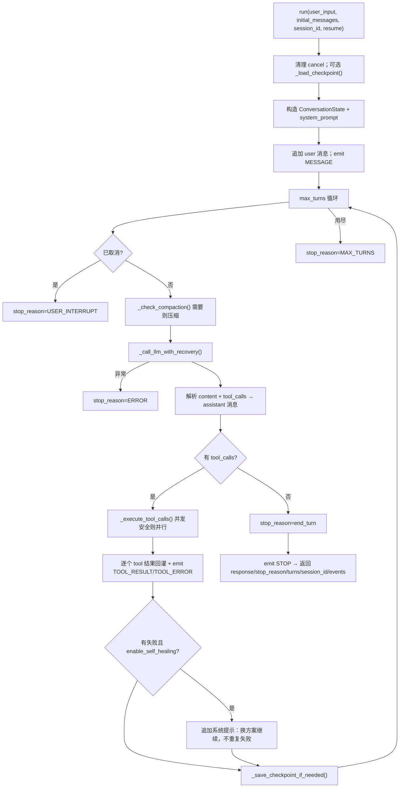

# 05 · Agent 运行时（AgentRuntime）

> 目录：`butler/core/agent_runtime/`（16 个文件）
> 定位：与 UI 完全解耦、可测试、可序列化的 **LLM 原生 tool calling 循环**。聊天主路径与 `butler agent run` 都最终落到这里。

## 5.1 设计参考与目标

代码注释明确对标 **Claude Code** 的极简循环与 **OpenHands V1** 的无状态 Agent：

```text
while True:
    response = callLLM(system_prompt, messages, tools)
    if no tool_calls: return response        # end_turn
    results = execute(tool_calls)            # 逐个/并行执行
    messages += results                      # 结果回灌
```

核心特性：UI 解耦、状态可保存/恢复、headless 可用、工具执行超时、失败信息回灌给 LLM 重试（自愈提示）。

## 5.2 模块地图

| 文件 | 关键内容 | 作用 |
| :--- | :--- | :--- |
| `agent_runtime.py` | `AgentRuntime`、`AgentConfig` | 主循环、并行工具、权限授权、断点续跑 |
| `types.py` | `EventType`、`PermissionLevel`、`StopReason`、`Message`、`ToolCall`、`ToolResult`、`Event`、`ConversationState` | 核心数据模型 |
| `tool_registry.py` | `ToolExecutor`、`ToolRegistry` | JSON Schema 驱动的工具注册/校验/执行 |
| `builtin_tools.py` | `register_builtin_tools()` | read/write/edit/multi_edit/glob/grep/ls/delete/move/copy/bash |
| `skill_tools.py` | `register_skill_tools()` | 把技能注册为标准工具 |
| `native_tools.py` | `register_native_tools()` | `native_call` / `native_status`（BHL） |
| `permission.py` | `PermissionSystem`、`PermissionMode` | 三层权限 + glob + auto 分类器 |
| `context_manager.py` | `ContextManager`、`CompactionStage` | Token 预算驱动的四阶段压缩 |
| `condenser.py` | `ImportanceScorer`、`BudgetCondenser` | 重要性感知压缩，生成上下文卡片 |
| `event_stream.py` | `EventStream` | 追加式事件日志 + 确定性重放 |
| `subagent_manager.py` | `SubagentManager`、`SubagentDefinition` | 隔离上下文的子代理委托 |
| `mcp_client.py` | MCP Client | 接入 Model Context Protocol 工具服务器 |
| `docker_sandbox.py` | Docker Sandbox | 容器级隔离执行 |
| `butler_adapter.py` | `ButlerAgentBridge` | 把 Butler 服务适配成 AgentRuntime 组件 |
| `cli.py` | headless CLI | 不初始化 GUI/语音的命令行入口 |

## 5.3 `AgentRuntime.run()` 主流程



返回结构：

```python
{
  "response": "最终回复",
  "stop_reason": "end_turn | max_turns | length | error | user_interrupt | permission_denied",
  "turns": 3,
  "session_id": "可选（启用 checkpoint 时）",
  "events": [...]
}
```

### 关键实现点

- **终止判定**：只以“本轮是否产生 tool_calls”为准，避免部分 OpenAI 兼容服务返回 `finish_reason=stop` 却仍带工具调用。
- **并行执行**：`max_parallel_tools`（默认 4）控制同轮并发；写类工具始终串行（`_is_concurrency_safe`）。
- **上下文超限恢复**：`_call_llm_with_recovery()` 捕获常见上下文错误特征（`context length`、`prompt too long` 等），先压缩（REACTIVE）再重试，最多 `max_context_retries` 次，最后 COLLAPSE。
- **断点续跑**：`checkpoint_dir` 非空时按 `session_id` 落盘；`resume=True` 恢复后续跑，且不重复追加历史用户输入。
- **取消**：`request_cancel()` 置位事件，在轮次边界与工具执行间隙检查。

## 5.4 工具系统

### 内置工具（FileEditor + Bash）

`register_builtin_tools(registry, workspace_root)` 注册 11 个工具：

| 工具 | 用途 | 权限倾向 |
| :--- | :--- | :--- |
| `read` | 读取文件（支持行范围） | 只读 |
| `write` | 创建/覆盖文件 | 需确认 |
| `edit` | 精确字符串替换 | 需确认 |
| `multi_edit` | 单文件批量编辑 | 需确认 |
| `glob` | 文件模式匹配 | 只读 |
| `grep` | 正则内容搜索 | 只读 |
| `ls` | 列目录 | 只读 |
| `delete` | 删除文件/目录（递归） | 危险 |
| `move` | 移动/重命名 | 需确认 |
| `copy` | 复制（递归） | 需确认 |
| `bash` | 持久 Shell 会话执行 | 需确认（危险命令拒绝） |

所有文件路径经 `_safe_path()` 约束在 `workspace_root` 内，防止越界。

### 技能工具

`register_skill_tools(registry, skill_manager, butler_app, max_tools)`：
- 只注册**可执行**技能（有 Python/二进制入口）；纯 `SKILL.md` 指令型技能走系统提示注入，不占工具位。
- 技能名做 OpenAI 函数名清洗（仅 `[A-Za-z0-9_-]`，≤64 字符），返回 `{tool_name: skill_id}` 反查表。
- LLM 传入的 `action` 表示动作，其余键作为 kwargs 透传，同时整包参数作为 `entities` 兼容旧式 `handle_request(action, entities=...)`。
- 结果统一收敛为 `ToolResult`，单次输出截断至 12000 字符。

### 原生工具（BHL）

`native_tools.py` 注册：
- `native_call`：`{"method": "...", "params": {...}, "module": "可选"}`
- `native_status`：查看模块构建/运行状态

LLM 可据此自行决定“这段计算交给 C++ / 哈希交给 Rust / 并发扫描交给 Go”（详见 [08 BHL](./08-bhl.md)）。

### 工具注册表

`ToolRegistry`：`register()` / `get()` / `get_schemas()` / `execute()`；`ToolExecutor.validate_arguments()` 按 JSON Schema 校验；`get_read_only_tools()`、`get_concurrency_safe_tools()` 供权限与并发调度使用。

## 5.5 权限系统（三层 + 多模式）

`permission.py`：

| 层级 `PermissionLevel` | 含义 |
| :--- | :--- |
| `ALWAYS_ALLOW` | 只读操作，静默执行 |
| `REQUIRE_CONFIRM` | 状态修改，需确认 |
| `NEVER_ALLOW` | 危险操作，永远阻止 |

| 模式 `PermissionMode` | 行为 |
| :--- | :--- |
| `default` | 破坏性操作需确认 |
| `accept_edits` | 自动接受文件编辑 |
| `auto` | 轻量规则分类器自动批准安全操作 |
| `plan` | 计划模式，只读 |
| `bypass_permissions` | 绕过确认（CI/CD） |
| `dont_ask` | 不询问，静默拒绝非允许操作 |

匹配支持 glob：`allow: ["Read(*)", "Bash(git *)"]`、`deny: ["Bash(rm -rf *)"]`。
配置项：`agent.permission_mode`、`agent.auto_confirm`（无 UI 时自动批准非只读工具；`rm -rf /`、`mkfs`、`dd if=` 等自毁命令始终拒绝）。

## 5.6 上下文压缩（四阶段）

`ContextManager`（默认 `token_limit=120000`、`compaction_threshold=0.8`）：


- `should_compact(state)`：估算 token 超阈值时触发。
- `BudgetCondenser`：按 `ImportanceScorer`（角色、位置、内容类型、工具结果等）保留高价值消息，把被丢弃消息压成“上下文卡片”。
- 与旧路径的 `NLUService.compress_history()` 并存：旧意图循环用简单压缩，新运行时用这套四阶段管道。

## 5.7 子代理、MCP 与沙箱

- **子代理**：`SubagentDefinition.from_markdown()` 支持 Markdown 定义（frontmatter + 指令）；`SubagentManager.delegate()` 在隔离上下文中运行子任务并返回结果，避免污染主上下文；支持目录加载与按任务描述匹配。
- **MCP**：`mcp_client.py` 作为客户端接入 MCP 工具服务器，把外部工具纳入注册表。
- **Docker 沙箱**：`docker_sandbox.py` 提供容器级隔离执行环境；另有 `butler/core/code_sandbox.py`、`windows_sandbox.py` 覆盖代码执行与 Windows 原生隔离。

## 5.8 Butler 适配层：`ButlerAgentBridge`

`butler_adapter.py` 是“旧 Butler”与“新运行时”的桥梁：

1. 以 `os.getcwd()` / 配置的 `workspace_root` 为根，注册内置工具。
2. 注册 BHL 原生工具。
3. 按 `agent.max_skill_tools`（默认 40）注册技能工具。
4. （可选）`agent.expose_intents` 时把意图处理器也注册为工具。
5. 设置权限模式、上下文管理器（复用 `NLUService` 做摘要）、事件流，并把事件桥接到 Butler UI 输出。
6. 生成 LLM 回调（OpenAI 兼容，支持多提供商，见 [14](./14-config-cli.md)）与系统提示词。
7. `run(command)` → 构造历史 → `runtime.run()` → 保存到长期记忆。

`Butler._autonomous_agent_loop` 优先调用它，异常自动回退旧循环。

## 5.9 `butler/agent/`：数字员工

`butler/agent/agent.py` 的 `Agent.run_task()` 直接驱动 `AgentRuntime`，任务状态写入 SQLite `tasks` 表（表缺失自动补建）。旧版 `planner.py` / `executor.py` / `verifier.py` 仍在，但执行器强调“按工具名执行真实工具，绝不返回伪造结果”。CLI：`butler agent list|run <role> <task>`（支持 `--session`、`--resume`）。

## 5.10 相关章节

- 新旧路径与意图：[06 意图与 NLU](./06-intent-nlu.md)
- 技能如何变成工具：[07 技能系统](./07-skills.md)
- 原生工具调用：[08 BHL](./08-bhl.md)
- 工具实现与打包：[18 开发指南](./18-dev-guide.md)
