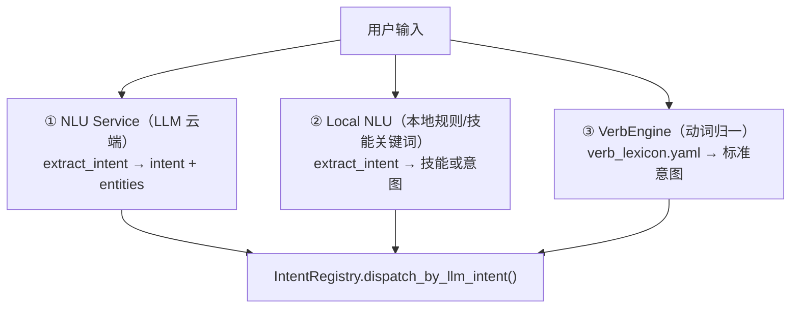

# 06 · 意图与 NLU

> 相关文件：`butler/core/nlu_service.py`、`butler/core/local_nlu.py`、`butler/core/intent_dispatcher.py`、`butler/core/intents/*`、`butler/core/legacy_commands.py`、`butler/core/verb_engine.py`

## 6.1 三层输入理解

Butler 对用户输入有三条并行的理解通道：



| 通道 | 实现 | 特点 |
| :--- | :--- | :--- |
| 云端 NLU | `NLUService.extract_intent()` | 需要 LLM；输出严格 JSON `{intent, entities}`；带提示注入检测与习惯画像增强 |
| 本地 NLU | `LocalNLU.extract_intent()` | 无网可用；基于技能关键词/规则匹配，返回 `(intent, entities, source)` |
| 动词引擎 | `VerbEngine` + `intents/verb_lexicon.yaml` | 把自然语言动词/宾语归一为规范意图，减少 LLM 歧义 |

> 新架构（AgentRuntime）优先让 LLM 直接调用工具；以上意图通道主要服务 **旧兜底循环** 与本地精确执行。

## 6.2 `NLUService`

`class NLUService`（`nlu_service.py`）：

| 方法 | 作用 |
| :--- | :--- |
| `__init__(api_key, prompts)` | 按 `AI_PROVIDER` 动态解析 provider / base_url / model / key，读取温度与 max_tokens |
| `extract_intent(text, history)` | 调用 LLM 抽取 `intent + entities`；注入用户习惯画像 |
| `generate_general_response(text)` | 通用对话回复 |
| `ask_llm(prompt, history, use_habit, system_override, image_b64)` | 底层 LLM 调用；支持多模态图片（base64） |
| `estimate_tokens(messages)` | 粗略 token 估算 |
| `compress_history(history)` | 旧循环的上下文压缩 |
| `_is_prompt_injection(text)` | 识别常见提示注入模式（中英文） |

- 配置解析：`_resolve_ai_config(provided_api_key)` 依次读取 `config_manager` → 环境变量 → `config_loader`，回退 DeepSeek。
- 兼容的 provider 与默认值定义在 `llm_providers.py`（DeepSeek / OpenAI / 智谱 / Anthropic / Gemini / 通义 / 文心 / Ollama）。
- 注意：`butler/core/api.py` 的就绪探针会读取 `NLUService.api_available`，但当前 `nlu_service.py` 并未定义该属性，实际会走 `except` 分支并把 NLU 标记为 `error`/`degraded`（已知缺陷，见 [15](./15-dependencies.md)）。

## 6.3 `LocalNLU`

`class LocalNLU`：
- `extract_intent(text)`：先在技能清单中按关键词匹配技能；未命中再走本地规则；返回 `(intent_id, entities, source)`。
- `_extract_entities_for_intent(intent_id, text)` / `_generic_entity_extraction(text)`：从文本抽取路径、数字、程序名等实体。
- 价值：在断网/无 Key 时仍能完成打开程序、排序、查时间等确定性任务。

## 6.4 意图注册表 `IntentRegistry`

`butler/core/intent_dispatcher.py` 提供全局单例 `intent_registry` 与可直接导入的装饰器 `register_intent`：

```python
from butler.core.intent_dispatcher import register_intent

@register_intent("workflow_create", source="llm")
def handle_workflow_create(container, entities, **kwargs):
    wf_engine = container.resolve("workflow_engine")
    ...
```

### 注册

`register(intent_name, requires_entities=True, source="local"|"llm")` 把函数与元数据（docstring、是否需实体、来源）存入索引，分别归入 `_llm_handlers` / `_local_handlers`。

### 分发

| 方法 | 说明 |
| :--- | :--- |
| `dispatch(intent, **kwargs)` | 直接调用（无弹性层） |
| `dispatch_by_llm_intent(intent, **kwargs)` | **LLM 意图专用**：限流 → 熔断 → 超时 → 指标采集；返回 `(found, result)` |
| `match_intent_locally(command, threshold=0.7)` | 基于 docstring 的余弦相似度本地匹配 |
| `get_metrics()` / `reset_circuit_breaker()` / `get_all_intents()` | 运维与诊断 |

### 内置弹性层

| 参数 | 默认 | 作用 |
| :--- | :--- | :--- |
| `_DEFAULT_TIMEOUT` | 5s | 单次意图执行超时 |
| `_CB_FAILURE_THRESHOLD` | 5 | 连续失败触发熔断 |
| `_CB_RECOVERY_SECONDS` | 30s | 半开恢复等待 |
| `_RATE_LIMIT_WINDOW` / `_MAX_CALLS` | 60s / 60 次 | 速率限制 |

超时/异常不会中断主循环，而是返回 `{"error": ...}` 并记录指标；`/readyz` 会暴露熔断状态。

## 6.5 意图 handler 包

`butler/core/intents/` 按领域拆分，导入包即触发装饰器注册：

| 文件 | 覆盖意图 |
| :--- | :--- |
| `action_intents.py` | 动作桥接、上下文管理 |
| `task_intents.py` | 任务创建/查询/更新/认领 |
| `team_intents.py` | 团队协作 |
| `workflow_intents.py` | 工作流 list/create |
| `timemachine_intents.py` | 时光机回溯 |
| `cluster_intents.py` | 集群节点管理 |
| `vault_intents.py` | 密钥保管 |
| `topic_intents.py` | 话题切换/回到之前话题 |
| `verb_intents.py` | 动词引擎产出的标准意图（本地精确执行） |

`butler/core/legacy_commands.py` 另注册了一批历史意图：`sort_numbers`、`find_number`、`calculate_fibonacci`、`edge_detect_image`、`text_similarity`、`open_program`、`get_current_time`、`cleanup`、`query_local_knowledge`、`index_local_files`、`cloud_upload/download/list` 等；这些 handler 通过 `butler_app` 注入直接调用 `speak()`。

## 6.6 工作流 DAG 的意图协作

`workflow_create` 意图可接收自然语言步骤，由 `NLUService.ask_llm()` 解析成：

```json
[{"id": "s1", "intent": "open_program", "entities": {...}, "depends_on": []}]
```

再交给 `WorkflowEngine`（`butler/core/workflow_engine.py`）按依赖调度执行（详见 [10 KAIROS / 工作流](./10-kairos.md)）。

## 6.7 输入安全

- `NLUService._is_prompt_injection()`：识别 “ignore previous instructions / 忽略之前的指令 / developer mode” 等模式。
- `IntentRegistry` 的限流与熔断防止恶意高频调用。
- `ActionBridge` 的 `_validate_safe_url()`：SSRF 防护（仅 http/https，拒绝内网/回环/链路本地地址）。

## 6.8 相关章节

- 新式循环：[05 Agent 运行时](./05-agent-runtime.md)
- 技能匹配：[07 技能系统](./07-skills.md)
- 错误码规范：仓库 `docs/dev/ERROR_CODES.md`（`BTL-xxxx`）
