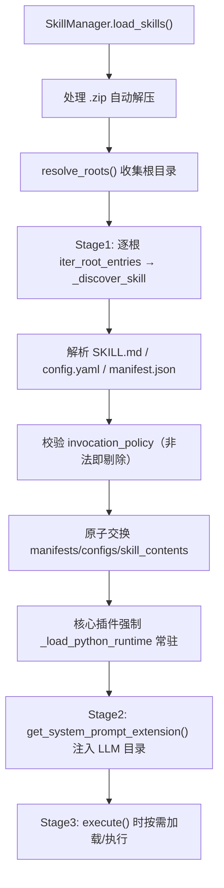
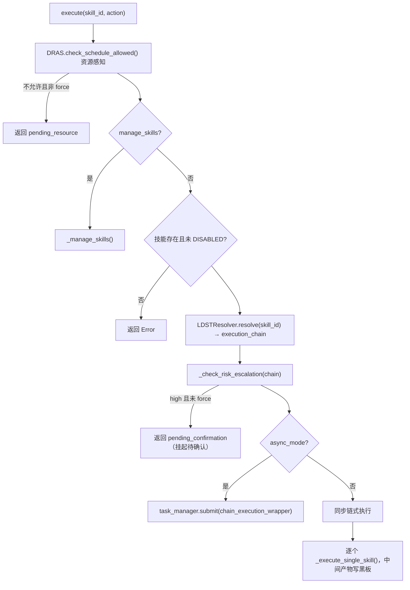

# 07 · 技能系统（One Folder = One Skill）

> 相关文件：`butler/core/skill_manager.py`（~55KB）、`butler/core/skill_registry.py`、`butler/core/skill_interceptor.py`、`butler/core/tool_bridge.py`、`butler/core/skill_sdk.py`、`butler/core/plugin_bundle.py`、`butler/core/algorithms.py`（LDST/DRAS）、`skills/*`

## 7.1 设计理念

> **一个功能目录只需包含 `SKILL.md` 和代码，即可在运行时自动扫描、热加载并直接由 LLM 感知。零污染、高便携。**

技能是 Butler 最主要的能力扩展方式；`skills/` 下现有约 49 个技能目录（含 3 个核心插件）。

## 7.2 一个技能长什么样

```text
skills/calculator/
├── SKILL.md        # 必选（推荐）：frontmatter 元数据 + 给 LLM 的指令
└── main.py         # 可选：Python 实现，导出 handle_request(action, **kwargs)

skills/hello_cli/
├── SKILL.md
└── __init__.py     # 也可用 __init__.py

skills/core_plugins/system_monitor/
├── SKILL.md
└── main.py         # 导出 initialize_core(context) 获取特权上下文
```

### `SKILL.md` frontmatter 字段

```yaml
---
name: calculator
description: 全能科学计算器与单位换算器。
provides: [math.calculate, math.convert]
requires: {}
risk: low
keywords: [计算, 计算器, 换算, 单位, 数学]
---
```

| 字段 | 含义 |
| :--- | :--- |
| `name` / `description` | 展示名与描述（`description` 会进入技能目录供 LLM 感知） |
| `provides` | 声明的输出键（LDST 影子链、黑板传递、风险升级判断） |
| `requires` | 需要的上游输入（从黑板快照注入） |
| `risk` | `low` / `high`；`high` 触发二次确认 |
| `keywords` | 本地匹配用关键词 |
| `isolation` | `process` 表示子进程隔离执行 |
| `disable-model-invocation` / `user-invocable` | dsh 兼容的可见性策略（见下） |

> 拼写错误（如 camelCase）或非法布尔值会使该技能整体失效（`invocation_valid=false`）。

## 7.3 技能发现根与优先级

`resolve_skill_roots()`（`skill_registry.py`）按优先级发现，**同名 first-wins**：

| 优先级 | 来源 | 路径 | 规则 |
| :--- | :--- | :--- | :--- |
| 0 | Butler 原生 | `<项目>/skills/` | 支持分类子目录（深度 2）与扁平 `.md` |
| 50–52 | 插件包 | `<项目>/plugins/<plugin>/` | `skills/`、`commands/`、`agents/` |
| 100 | dsh 项目级 | `<项目>/.dsh/skills/` | 仅直接子项 |
| 200 | Agents 项目级 | `<项目>/.agents/skills/` | 仅直接子项 |
| 210 | Claude 项目级 | `<项目>/.claude/skills/` | 仅直接子项 |
| 400 | dsh 用户级 | `~/.dsh/skills/`（`DSH_HOME` 覆盖） | 仅直接子项 |
| 500 | Agents 用户级 | `~/.agents/skills/`（`DSH_AGENTS_HOME` 覆盖） | 仅直接子项 |
| 510 | Claude 用户级 | `~/.claude/skills/` | 仅直接子项 |

外部根支持目录 bundle 与扁平 `<name>.md`。插件包（dsh / Claude Code）采用**导入式兼容**：解析声明式资产，不执行 TS/JS 运行时。

## 7.4 加载流水线（Stage 1 → 2 → 3）



- **Stage 1**：只发现与提取元数据，不加载重型运行时；`watchdog` 监听 `skills/` 变化（新增/修改/删除），防抖后热重载。
- **Stage 2**：`get_system_prompt_extension()` 把可用技能目录写进系统提示词；命中技能时把 `SKILL.md` 指令注入上下文。
- **Stage 3**：真正执行时再解析依赖并加载 Python/二进制入口（懒加载）。

### 元数据来源优先级

`_discover_skill()` 依次尝试：
1. `SKILL.md`（AI 友好，推荐）或扁平 `.md`
2. `config.yaml`（系统/硬件友好）
3. `manifest.json`（旧版规范，仅当前面未命中）

### 状态与热插拔

- `skill_status[skill_id]`：`ENABLED` / `DISABLED`（故障隔离）。
- `SkillEventHandler` 监听文件变化，触发 `load_and_register_skill()` 增量重载或 `unload_skill()`。
- `skills-lock.json` 记录启用列表与外部来源哈希。

## 7.5 执行模型

`SkillManager.execute(skill_id, action, **kwargs)`：



### 单个技能执行分派 `_execute_single_skill`

1. 注入 `requires` 对应的黑板快照。
2. 有二进制且 `action=="run"` → `_execute_binary()`。
3. `action` 以 `scripts/` 开头 → `_execute_allowed_script()`（allowed-tools 白名单）。
4. 有 Python 入口：
   - 核心插件 → 主进程加载（特权上下文）。
   - 声明 `isolation: process` 或 `provides` 含 `system./net./file.` → `_execute_python_subprocess()`（子进程隔离）。
   - 其余 → 主进程加载并打印“强烈建议重构”警告。
5. 均未命中 → 返回可读错误。

### 资源感知（DRAS）与影子链（LDST）

- **DRAS**（`DynamicResourceManager`，`algorithms.py`）：根据 CPU/内存/电量决定是否允许调度；返回 `pending_resource` 而非硬失败。
- **LDST**（`LDSTResolver`）：按 `provides`/`requires` 解析出技能依赖链（拓扑序），支持“影子链”式组合执行；中间结果写入 `EphemeralBlackboard` 供下游消费。
- **风险分级**：`_check_risk_escalation()` 对显式 `risk: high`、`requires` 含 admin/root、`provides` 命中 `net.exploit`/`file.deleted`/`auth.privilege.escalated` 等模式提权。

## 7.6 与 LLM / 工具的关系

| 接入方式 | 实现 | 说明 |
| :--- | :--- | :--- |
| 技能作为工具 | `agent_runtime/skill_tools.py` | 仅注册可执行技能；LLM 直接调用 |
| 技能指令注入 | `get_system_prompt_extension()` + Stage 2 | 指令型技能以提示词形式被“使用” |
| 导出 OpenAI 工具 | `SkillManager.export_openai_tools()` | 供其他集成/测试用 |
| 技能访问内置工具 | `tool_bridge.get_tools()` | 技能内部可调用 read/write/edit/bash |

### 技能内调用内置工具的示例

```python
from butler.core.tool_bridge import get_tools

def handle_request(input_text, **kwargs):
    tools = get_tools()
    content = tools.read(path="some_file.py")
    tools.edit(path="config.yaml", old_string="old", new_string="new")
    result = tools.bash(command="ls -la")
    return {"content": f"Done: {result}"}
```

## 7.7 命令拦截（SkillInterceptor）

`skill_interceptor.py` 在 LLM 生成的 Shell 命令执行前做智能重定向：识别 `pandoc` / `pdf2docx` / `libreoffice` / `soffice` 等，改为调用 Butler 本地更安全高效的技能（格式转换、压缩等），避免直接执行外部命令。

## 7.8 技能 CLI

```bash
python butler_cli.py skill list            # 列出全部技能（含来源）
python butler_cli.py skill list -j         # JSON 输出 source / 可见性
python butler_cli.py skill info <id>       # 来源、调用策略与指令
python butler_cli.py skill run <id>        # 运行 USER 技能
python butler_cli.py skill uninstall <id>  # 卸载原生技能
python butler_cli.py skill roots           # 查看发现根目录

python butler_cli.py plugin add ./my-plugin
python butler_cli.py plugin list
python butler_cli.py plugin info my-plugin
python butler_cli.py plugin remove my-plugin
```

另有 `butler/core/skill_sdk.py` 为移动端（Chaquopy）/嵌入式场景提供 SDK 与 DRAS 节流钩子。

## 7.9 核心插件

`skills/core_plugins/`（`clipboard_history`、`quick_launcher`、`system_monitor`）由 `SkillManager` 强制加载并常驻内存，通过 `initialize_core(context)` 获取 `CorePluginContext`（`event_bus`、`message_bus`、`blackboard`、`data_storage`、`system_sensor`）特权访问内部模块。

## 7.10 新增技能（最短路径）

1. 在 `skills/` 下新建目录，写 `SKILL.md`（frontmatter + 指令）。
2. 如需执行逻辑，加 `main.py` / `__init__.py`，导出 `handle_request(action, **kwargs)`。
3. 保存即触发 watchdog 热加载；用 `/skills`、`/skill-info <id>` 或 CLI 验证。

详见 [18 开发指南](./18-dev-guide.md)。
