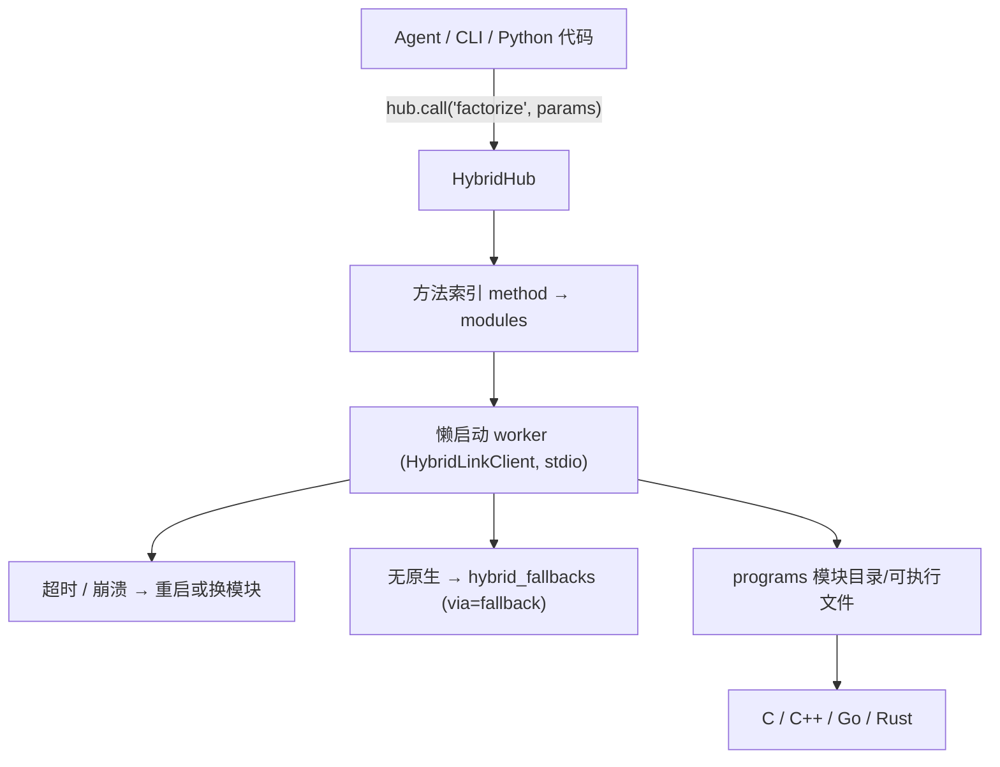

# 08 · BHL 混合链路（Butler Hybrid Link）

> 相关文件：`butler/core/hybrid_hub.py`、`hybrid_link.py`、`hybrid_router.py`、`hybrid_fallbacks.py`、`hybrid_scaffold.py`、`agent_runtime/native_tools.py`、`butler/cli/hybrid_cmd.py`、`programs/*`、`docs/bhl.md`

## 8.1 它解决什么问题

纯 Python Agent 在高并发网络、低延迟计算、高强度加解密、系统级操作上性能不足。BHL 把 C / C++ / Go / Rust 模块接到同一条链路上，统一：

- **发现**：扫描 `programs/*/manifest.json`
- **构建**：按 manifest 的 build 命令调用 gcc / g++ / go / cargo
- **路由**：`method -> [模块...]`，优先已构建/已运行
- **执行**：懒启动子进程 + JSON-RPC 行协议 + 超时/崩溃重启
- **回退**：无可用原生模块时走 Python 回退，并显式标注 `via="fallback"`

## 8.2 调用链



### 统一返回信封

```json
{
  "ok": true,
  "method": "factorize",
  "module": "hybrid_compute",
  "language": "cpp",
  "via": "native:cpp",
  "result": {"factors": [7, 13]},
  "elapsed_ms": 2.1
}
```

`via` 明确区分 `native:<语言>` 与 `fallback`，杜绝“看起来成功、其实是假数据”。

## 8.3 manifest 约定

```json
{
  "name": "hybrid_compute",
  "language": "cpp",
  "version": "1.0",
  "description": "...",
  "protocol": "bhl",
  "build": "g++ -O3 compute.cpp -o hybrid_compute_exec",
  "source": ["compute.cpp"],
  "executable": "hybrid_compute_exec",
  "methods": ["factorize", "fibonacci"]
}
```

| 字段 | 说明 |
| :--- | :--- |
| `language` | `c` / `cpp` / `c++` / `go` / `rust`（另有 `typescript`、`python` 模块） |
| `protocol` | `bhl`（常驻 stdio worker）或 `cli`（一次性工具） |
| `build` / `build_command` | 构建命令；支持 `{output}` 占位 |
| `executable` / `entry.executable` | 可执行文件相对路径（可为 `{"path": ..., "args": [...]}`） |
| `methods` | 方法列表，或 `{方法名: {argv: [...]}}`（CLI 模式） |

`HybridHub.__init__` 支持参数：`programs_dir`、`fallback_enabled`、`call_timeout`（默认 15s）、`build_timeout`（默认 600s）。

## 8.4 JSON-RPC 行协议

`HybridLinkClient.call(method, params, timeout, wait, priority)` 发送：

```json
{"jsonrpc": "2.0", "method": "factorize", "params": {"number": 91}, "id": "<uuid>", "priority": 5}
```

- 模块在 stdout 逐行输出 JSON；带 `id` 的是响应，不带 `id` 的被视为事件（回调 `register_event_callback`）。
- stderr 被记录为错误日志。
- 支持 `fallback_enabled`：进程未启动时直接调用 Python 回退。

## 8.5 已接入模块一览

| 模块 | 语言 | 协议 | 方法 |
| :--- | :--- | :--- | :--- |
| `hybrid_sysutil` | C | bhl | get_system_info, list_processes, grep_search, glob_list, patch_edit, detect_displays, check_connections |
| `hybrid_compute` | C++ | bhl | factorize, fibonacci |
| `hybrid_math` | C++ | — | get_stats, matrix_test |
| `hybrid_doc_processor` | C++ | — | analyze_file |
| `hybrid_vision` | C++ | — | process_test |
| `hybrid_memory` | Go | — | search, get_stats |
| `hybrid_net` | Go | bhl | check_network, scan_ports, batch_ping, benchmark, concurrent_download |
| `hybrid_system_executor` | Go | bhl | audit, log_scan, remote_dispatch, discover_nodes, get_stats |
| `hybrid_memos` | Go | — | add_memo, list_memos, search_memos, update_memo, delete_memo |
| `hybrid_crypto` | Rust | bhl | hash_sha256, hash_file, encrypt_file, decrypt_file |
| `word_counter` | C | cli | count_words |
| `hybrid_archive` | C++ | cli | stream_replace |
| `butler_runner` | Go | — | 远程执行节点（WebSocket，另行通信） |
| `bcli` / `ble_framework` / `hybrid_terminal` / `hybrid_ts_tool` / `markitdown_gui` 等 | 混合 | — | 按需接入或独立运行 |

> 同名方法（如 `get_stats`）通过 `--module` 显式指定。

## 8.6 Python 回退

`hybrid_fallbacks.py` 为关键方法提供纯 Python 实现：`factorize`、`fibonacci`、`check_network`、`scan_ports`、`hash_sha256`、`get_system_info`、`list_processes`、`fast_file_search`、`benchmark`、`concurrent_download`、`batch_ping`、`audit_dir`、`log_scan`、`discover_nodes`、`remote_dispatch`、`get_stats_fallback`。`dispatch_fallback(method, params)` 统一入口。

## 8.7 构建与调用（CLI）

```bash
butler hybrid status
butler hybrid build
butler hybrid build hybrid_crypto --force
butler hybrid call factorize --params '{"number": 91}'
butler hybrid call hash_sha256 --module hybrid_crypto --params '{"text":"butler"}'
butler hybrid new image_ops --lang cpp   # c / cpp / go / rust / python
```

- `status` 输出：模块 / 语言 / 是否已构建 / 是否运行 / 方法。
- `build` 缺工具链会自动跳过并说明原因；`--force` 强制重编。
- `new` 生成 `manifest.json` + 可运行的最小 stdio worker（`ping`/`echo`/`exit`），无需改 Python 代码即可被 `HybridHub` 发现。

## 8.8 Agent 集成

`agent_runtime/native_tools.py` 自动注册：
- `native_call`：`{"method": "...", "params": {...}, "module": "可选"}`
- `native_status`：查看模块构建/运行状态

因此 LLM 可以自主决定“这段计算交给 C++、哈希交给 Rust、并发扫描交给 Go”。

## 8.9 工具链与限制

| 问题 | 说明 |
| :--- | :--- |
| 工具链缺失 | 需要 `gcc` / `g++` / `go` / `cargo`；缺失时 `build` 跳过 |
| Rust 版本 | `edition` 2021、`Cargo.lock` v3，兼容 rustc 1.75+ |
| `hybrid_memos` | 依赖 cgo + sqlite3，需能访问 Go 模块代理 |
| 预编译二进制 | 架构不匹配时 `butler hybrid build <module> --force` 重编 |
| `bcli` | STM32 串口控制器，不走 stdio，不在路由表 |
| HTTP/FFI 第三方库 | 需先包一层 stdio worker 或 CLI 才能接入 |

## 8.10 相关章节

- 新增 BHL 模块流程：[18 开发指南](./18-dev-guide.md)
- Python 回退与安全：[15 依赖关系](./15-dependencies.md)
- 远程执行节点：[11 运行时服务](./11-runtime-services.md)
