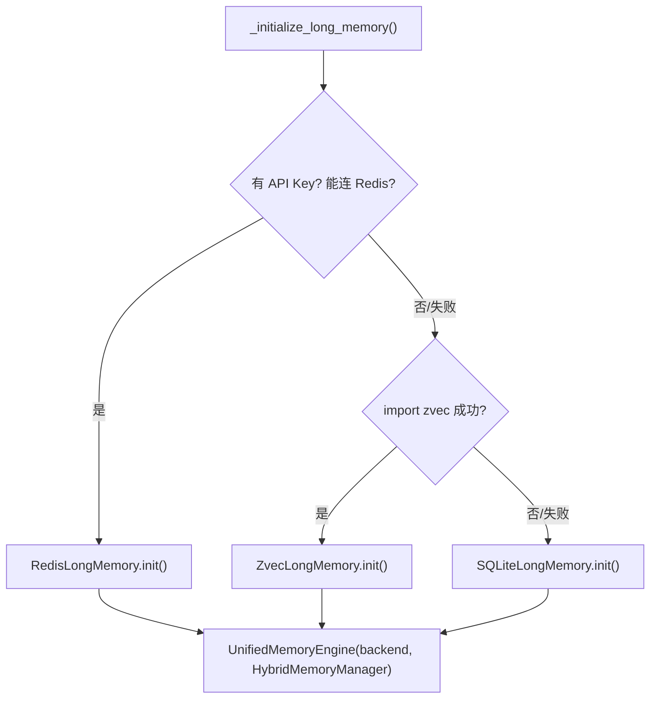
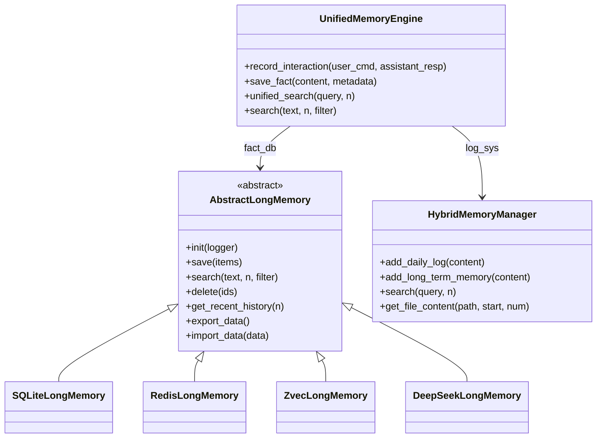

# 09 · 记忆系统

> 相关文件：`butler/core/memory/memory_engine.py`（主记忆栈）、`butler/core/memory/input_memory.py`、`butler/core/memory/PluginManager.py`、`butler/memory/manager.py`、`butler/memory/short_term.py`、`butler/memory/long_term.py`、`butler/core/dream_engine.py`、`butler/core/habit_manager.py`

## 9.1 多级降级：Redis → Zvec → SQLite

Butler 的“杀手级”设计之一：**没有云端向量库、没有 Docker 也能跑**。`Butler._initialize_long_memory()` 依次尝试：

| 后端 | 类 | 特点 |
| :--- | :--- | :--- |
| Redis 向量库 | `RedisLongMemory` | 需要 `redis`/`redisvl` 与 API Key；语义向量检索 |
| 本地嵌入式向量库 | `ZvecLongMemory` | 阿里云开源的本地向量库，秒级语义搜索，无需外部服务 |
| SQLite（兜底） | `SQLiteLongMemory` | 支持 FTS5 全文搜索；完全离线；`long_memory.db` |

> 统一抽象：`AbstractLongMemory`（`init/save/search/delete/get_recent_history/export_data/import_data`）。`LongMemoryItem` 是标准记忆项（content / id / metadata / distance）。

## 9.2 主记忆栈类图

### `UnifiedMemoryEngine`（统一记忆引擎）

| 方法 | 行为 |
| :--- | :--- |
| `record_interaction(user_cmd, assistant_resp)` | 同时写“每日日志”与“事实库” |
| `save_fact(content, metadata)` | 存一条长期事实（`speak()` 会调用，role=assistant） |
| `unified_search(query, n)` | 合并事实库与日志的检索结果 |
| `search/save/delete/get_recent_history` | 委托底层 backend |
| `export_data/import_data` | 记忆迁移 |

### `HybridMemoryManager`

- `add_daily_log(content)`：按日期写入 `data/butler_memory/memory/YYYY-MM-DD.md`
- `add_long_term_memory(content)`：写入长期记忆
- `search(query, n)`：跨日志/长期记忆检索
- `get_file_content(path, start, num)`：读取记忆文件片段

## 9.3 SQLite 实现细节

`SQLiteLongMemory`：
- 数据库路径默认 `data/system_data/long_memory.db`（可通过 `collection_name` 区分）。
- `_init_or_recover_db()`：初始化或损坏恢复。
- `_create_table()`：创建记忆表与 FTS5 全文索引。
- `_sanitize_query()`：清洗查询串，防止 FTS 语法注入/报错。
- 带 `cache_size` LRU 缓存（默认 100）。

## 9.4 两套记忆系统的差异（重要）

| 位置 | 使用方 | 结构 |
| :--- | :--- | :--- |
| `butler/core/memory/memory_engine.py` | 桌面主程序 `Butler` | **三级降级**向量/全文记忆 + 每日日志 + 统一引擎 |
| `butler/memory/manager.py` | v2 `ButlerRuntime` | `ShortTermMemory`（会话，默认 20 条）+ `LongTermMemory`（SQLite `memory` 表） |

> 读代码时请先确认属于哪条路径：`ButlerRuntime`（`butler start`）用的是后者；TUI/GUI/Web/headless 用前者。两者数据库文件都指向 `data/system_data/long_memory.db`（表结构不同）。

## 9.5 其他记忆/画像

| 模块 | 作用 | 落盘 |
| :--- | :--- | :--- |
| `habit_manager` | 用户习惯画像，注入 LLM 系统提示，实现“多年老友”式默契 | `data/HABITS.md` + `data/local_storage/SystemHabitManager_user_habit_profile.json` |
| `dream_engine` | 后台整合碎片日志为结构化事实记忆 | `data/MEMORY.md`（超长自动修剪，`max_memory_lines` 默认 1000 行） |
| `input_memory` | 记录输入词频/最近使用，用于联想建议 | `data/system_data/input_memory.db` |
| `topic_manager` | 话题切换与回溯，解决“聊着聊着换话题就失忆” | 内存 + 数据存储 |
| `PluginManager` / `plugin_interface` | 旧式插件数据存储与结果封装 | `data/local_storage/*` |

## 9.6 记忆在交互中的使用点

1. **对话前**：`_get_conversation_history()` 从长期记忆取最近 N 条注入上下文。
2. **对话中**：`NLUService` 用习惯画像增强系统提示。
3. **对话后**：`speak()` / `bridge._save_to_memory()` 写入事实。
4. **后台**：`DreamEngine` 周期性提炼日志 → `MEMORY.md`。
5. **检索**：`unified_search()` 供知识库问答/技能使用。

## 9.7 相关章节

- 做梦整合细节：[10 KAIROS 自动化](./10-kairos.md)
- 配置与数据目录：[14 配置与 CLI](./14-config-cli.md)
- 备份/迁移：`butler/core/config_backup_manager.py`、`export_data/import_data`
