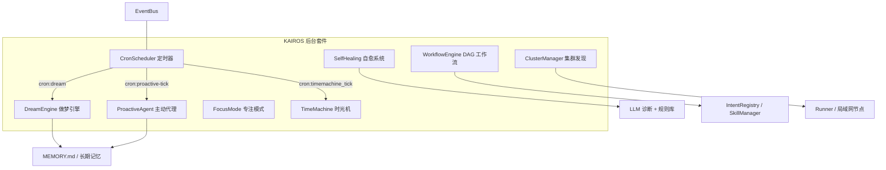

# 10 · KAIROS 自动化（后台智能）

> KAIROS 是 Butler 的“后台生命”：在系统闲置或定时触发时自动整合记忆、巡检健康、主动提醒、执行工作流。
> 相关：`butler/core/dream_engine.py`、`dream/`、`self_healing.py`、`proactive_agent.py`、`focus_mode.py`、`time_machine.py`、`cron_scheduler.py`、`cluster_manager.py`、`topic_manager.py`、`habit_manager.py`、`workflow_engine.py`、`sensing_api.py`、`battery_manager.py`、`resource_manager.py`

## 10.1 组件总览



`Butler._setup_kairos_tasks()` 负责把上述组件挂到 `cron_scheduler` 与 `event_bus` 上。

## 10.2 做梦引擎（Dream Engine）🧪

`butler/core/dream_engine.py` + `butler/core/dream/`（论文式“递归自我改进”实现：`discovery_tree.py`、`dreamer.py`、`orchestrator.py`、`policy.py`、`replay.py`）

`class DreamEngine`：

| 方法 | 作用 |
| :--- | :--- |
| `should_dream()` | 判断是否满足做梦条件（系统闲置/负载/时间） |
| `dream()` | 主流程：收集信号 → 整合 → 更新记忆 |
| `_gather_signals()` | 汇总过去约 3 天的交互日志/系统信号 |
| `_consolidate(signals)` | 用 LLM 提炼、去冗余，生成结构化知识 |
| `_update_and_prune_memory_md(new_knowledge)` | 写入并裁剪 `data/MEMORY.md`（`max_memory_lines` 默认 1000 行） |
| `_self_improve()` | 策略自改进（探索策略，见 `config.dream`） |

配置（`config/config.yaml` → `dream`）：

```yaml
dream:
  enabled: true
  data_dir: "data/dream"
  K1: 10      # 单次在线 rollout 最大决策轮数
  W: 4        # 并行 worker 数
  K2: 10      # 回放最大决策轮数
  M: 3        # 每次做梦评估的策略版本数
  beta1: 0.1  # 执行代价惩罚
  beta2: 0.1  # 并行度奖励
  dream_every: 1
  seed: 0
```

## 10.3 自愈系统（Self-Healing）🧪

`butler/core/self_healing.py`：

| 方法 | 作用 |
| :--- | :--- |
| `analyze_failure(error_msg, context)` | 先匹配内置回退规则 `_FALLBACK_RULES`，命中即返回策略 |
| `_llm_analyze(...)` | 规则未命中时调用 LLM 生成修复/降级策略 |
| `add_rule(pattern, strategy, parameters, explanation)` | 动态扩充规则库 |

`AgentRuntime` 在工具失败时会把错误回灌给 LLM，并可选触发自愈分析（`enable_self_healing=True`），实现“无人工干预的重试/降级”。典型场景：端口占用、API 报错、命令超时。

## 10.4 主动代理（ProactiveAgent）

`butler/core/proactive_agent.py`：

| 方法 | 作用 |
| :--- | :--- |
| `update_activity()` | 每次用户交互刷新“最近活跃时间” |
| `tick()` | 定时检查：系统健康、当日总结、改进建议 |
| `_check_system_health()` | CPU/内存/磁盘异常提醒 |
| `_summarize_day()` | 生成当天工作摘要 |
| `_suggest_improvement()` | 给出改进建议 |
| `_take_initiative()` | 在合适时机主动发起 |

## 10.5 专注模式（FocusMode）

`focus_mode.start(duration_minutes=25)` 启动番茄钟式专注；`_mute_system()` / `_unmute_system()` 静音系统通知；`stop()` 提前结束。适合与语音/通知系统联动（见 `notifier_system.py`）。

## 10.6 时光机（TimeMachine）

`butler/core/time_machine.py`：

- SQLite 数据库：`data/system_data/time_machine.db`，表 `snapshots(timestamp, category, payload)`。
- `record(category, payload)` 记录快照；`ui_print()` 每次输出都会记一条 `ui_event`。
- `_record_system_snapshot`（Butler）每 30 秒记录系统指标；`_timemachine_cleanup(7)` 每天清理 7 天前快照。
- 前端“可观测时光机”象限据此做影音级回溯与异常高亮。

## 10.7 定时调度（CronScheduler）

`butler/core/cron_scheduler.py`：

- 持久化任务文件：`data/scheduled_tasks.json`；多实例锁：`data/.cron_lock`。
- 支持**电池感知抖动**（jitter）：电量低时降低触发频率。
- 与 `BatteryManager` 协作：`should_throttle()` / `get_sleep_multiplier()` 影响执行节奏。
- 另有一个轻量 `butler/core/scheduler.py` 的 `BackgroundScheduler`（`add_job(name, interval, callback)`），供 `ButlerRuntime` 使用。

## 10.8 工作流引擎（DAG）

存在两套工作流实现：

| 实现 | 特点 |
| :--- | :--- |
| `butler/core/workflow_engine.py`（Desktop） | 内存 DAG：`WorkflowStep(id, intent, entities, depends_on)`、`Workflow`、`WorkflowEngine`；`_schedule_next_steps()` 按依赖调度；`_run_step()` 通过意图/技能执行 |
| `butler/workflow/engine.py`（v2 Runtime） | YAML 工作流：`WorkflowParser` 解析 → `Executor` 执行，匹配已安装包/技能 |

创建流程：用户自然语言 → `workflow_create` 意图 → LLM 解析成 `steps` JSON → `create_workflow()` → `execute_workflow()`。前端 (1,0) 象限提供可视化拖拽 DAG 编辑器（`frontend/src/components/dag_engine.ts`）。

## 10.9 集群发现与话题/习惯

| 模块 | 作用 |
| :--- | :--- |
| `cluster_manager.py` | `start_discovery()` 局域网扫描其他 Butler/Agent 节点，配合 gRPC/Runner 做多端协同 |
| `topic_manager.py` | 话题栈：切换/回溯，避免长对话“失忆” |
| `habit_manager.py` | 习惯画像（`HABITS.md`），注入 NLU/对话提示 |
| `sensing_api.py` | 解析标准化传感器 JSON（如 `{"sensor":"distance","value":30,"unit":"cm"}`）并触发事件；REST `POST /sensor/data` 入口 |
| `battery_manager.py` / `resource_manager.py` | 电量/性能模式（NORMAL/ECO/HIGH_PERFORMANCE），驱动节流与 DRAS |
| `notifier_system.py` | 智能事件提醒（见 `docs/PRD_NOTIFIER_SYSTEM.md`） |

## 10.10 相关章节

- 记忆整合的存储：[09 记忆系统](./09-memory.md)
- 定时/通信基础设施：[11 运行时服务](./11-runtime-services.md)
- 前端时光机/DAG：[13 UI 与前端](./13-ui-frontend.md)
