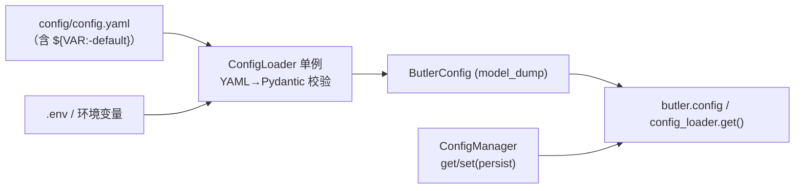

# 14 · 配置与 CLI

## 14.1 配置分层

Butler 的配置有三层来源，优先级由低到高近似为：默认值 → `config/config.yaml` → `.env` / 环境变量 → `ConfigManager` 运行时覆盖。



| 组件 | 文件 | 说明 |
| :--- | :--- | :--- |
| `ConfigLoader` | `package/core_utils/config_loader.py` | 单例；YAML 优先、JSON 兜底；`${VAR:-default}` 替换；`ButlerConfig` 校验失败则回退默认；`get("api.deepseek.key")` 点路径，找不到再查 `API_DEEPSEEK_KEY` 式环境变量 |
| `ConfigManager` | `butler/core/config_manager.py` | 可写配置：`get/set(persist)/save_yaml/reload/get_all/validate_required_keys` |
| `ButlerConfig` | `butler/core/config_model.py` | Pydantic 强类型模型；密钥类强制走 SecretVault |
| `config_loader._config` | — | 兼容旧代码的直接字典访问 |

## 14.2 `config/config.yaml` 主要段落

| 段落 | 关键键 | 说明 |
| :--- | :--- | :--- |
| `api` | `provider`、`base_url`、`model_name`、各 `*_key`、`baidu_*`、`picovoice_access_key`、`quota.consumed` | AI 提供商与密钥、语音 API |
| `voice` | `mode`（auto/native/local/baidu/google/azure/text）、`local_stt_model` | 语音引擎选择 |
| `persona` | `emotional_mode` | 人格/情绪 |
| `display` | `default_mode`、`theme`、`usb_screen.{width,height}` | 显示 |
| `performance` | `mode`（NORMAL/ECO/HIGH_PERFORMANCE） | 性能模式 |
| `interpreter` | `safety_mode`、`max_iterations` | 代码解释器 |
| `dream` | `enabled`、`data_dir`、`K1/W/K2/M`、`beta1/beta2`、`dream_every`、`seed` | 做梦引擎 |
| `runner_server` | `host`、`port`、`token` | 远程执行节点 |
| `update_source` | `assets_base_url`、`api_latest_release`、`python_runtime_urls` | 资源下载/更新 |
| `agent` | `runtime`、`max_turns`、`max_skill_tools`、`permission_mode`、`auto_confirm`、`expose_intents` | Agent 运行时 |

### 环境变量注入示例

```yaml
api:
  provider: "${AI_PROVIDER:-deepseek}"
  deepseek_key: "${DEEPSEEK_API_KEY:-}"
runner_server:
  token: "YOUR_RUNNER_SERVER_TOKEN_HERE"
```

## 14.3 `.env` 与环境变量

最小可用配置（`.env.example`）：

```env
AI_PROVIDER=deepseek
DEEPSEEK_API_KEY=YOUR_KEY_HERE
# 可选
# API_BASE_URL=http://localhost:11434/v1
# MODEL_NAME=
```

| 分类 | 变量（节选） |
| :--- | :--- |
| AI 提供商 | `AI_PROVIDER`、`CUSTOM_PROVIDER_NAME`、`API_BASE_URL`、`MODEL_NAME` |
| API 密钥 | `DEEPSEEK_API_KEY`、`OPENAI_API_KEY`、`ZHIPU_API_KEY`、`ANTHROPIC_API_KEY`、`GEMINI_API_KEY`、`DASHSCOPE_API_KEY`、`QIANFAN_API_KEY`、`CUSTOM_API_KEY` |
| 语音 | `BAIDU_APP_ID`、`BAIDU_API_KEY`、`BAIDU_SECRET_KEY`、`PICOVOICE_ACCESS_KEY` |
| 安全/服务 | `BUTLER_API_TOKEN`、`BUTLER_RUNNER_TOKEN`、`BUTLER_MASTER_PASSWORD`、`BUTLER_API_HOST`、`BUTLER_API_PORT` |
| 行为 | `BUTLER_VERBOSE_SKILLS`、`BUTLER_MODE`、`DSH_HOME`、`DSH_AGENTS_HOME` |

> 完整清单见仓库 `docs/start/env-reference.md`。密钥建议通过 `SecretVault`（`butler vault set ...`）持久化，而非明文写入 `.env`。

## 14.4 支持的 AI 提供商

| provider | 默认 Base URL | 默认模型 | Key 环境变量 |
| :--- | :--- | :--- | :--- |
| `deepseek`（默认） | `https://api.deepseek.com/v1` | `deepseek-chat` | `DEEPSEEK_API_KEY` |
| `openai` | `https://api.openai.com/v1` | `gpt-4o-mini` / `gpt-3.5-turbo`* | `OPENAI_API_KEY` |
| `zhipu` | `https://open.bigmodel.cn/api/paas/v4` | `glm-4-flash` | `ZHIPU_API_KEY` |
| `anthropic` | `https://api.anthropic.com/v1` | `claude-3-5-sonnet-20241022` | `ANTHROPIC_API_KEY` |
| `gemini` | `https://generativelanguage.googleapis.com/v1beta/openai` | `gemini-1.5-flash` | `GEMINI_API_KEY` |
| `dashscope` | `https://dashscope.aliyuncs.com/compatible-mode/v1` | `qwen-turbo` | `DASHSCOPE_API_KEY` |
| `qianfan` | `https://qianfan.baidubce.com/v2` | `ernie-4.0-8k` | `QIANFAN_API_KEY` |
| `ollama`（本地） | `http://localhost:11434/v1` | `llama3.1` | 无需鉴权 |
| `custom` | 由 `API_BASE_URL` 指定 | 由 `MODEL_NAME` 指定 | `CUSTOM_API_KEY` |

\* `config_model.py` 与 `llm_providers.py` 对 OpenAI 默认模型略有差异，以实际配置为准。

## 14.5 统一 CLI：`butler <命令>`

```bash
butler                 # 启动 TUI（默认）
butler tui             # Textual 终端界面
butler gui             # Tkinter 经典桌面
butler web             # pywebview 2×2 现代 Web UI
butler headless        # 无头后台 + API
butler start           # = butler api，启动 FastAPI REST 网关
butler api --port 5001 --host 0.0.0.0

butler init            # 首次配置向导（服务商 + Key 校验 + 示例任务）
butler config          # 交互式配置 AI 服务商与密钥
butler config show     # 查看当前 AI 配置
butler config check    # 配置健康检查（重复键/缺失项）
butler doctor          # 系统体检（带下一步建议）

butler agent list                      # 列出数字员工
butler agent run <role> "<task>"       # 委派任务（--session/--resume）
butler hybrid status|build|call|new    # BHL 模块
butler package list|install <path>     # 包管理
butler download <url>                  # 资源下载
```

### 功能型 CLI：`butler_cli.py`

`butler cli ...`（或直接 `python butler_cli.py`）提供更细的子命令（约 23 个 parser），如 `crawl`、`email`、`encrypt`、`translate`、`manage_skills`、`skill list|info|run|uninstall|roots`、`plugin add|list|info|remove` 等。

## 14.6 `butler doctor`：系统体检

`butler/core/doctor.py` 逐项检查并给出建议：
1. Python 版本（推荐 3.10/3.11）
2. 依赖完整性
3. 配置文件与密钥
4. SQLite 数据库与表
5. BHL 二进制/工具链
6. 目录与权限

`butler/core/capability_reporter.py` 在启动时额外输出能力矩阵（full/partial/absent），避免“静默降级”。

## 14.7 `butler init` 首次配置向导

`butler/cli/init_cmd.py` 的 `run_init(skip_check=False)`：
- 交互选择 AI 服务商；
- 写入/更新 `.env`；
- `_check_api_key()` 实测 Key 是否可用（可 `--skip-check` 跳过）；
- 给出示例任务，3 分钟跑通。

## 14.8 配置文件与数据目录

| 路径 | 内容 |
| :--- | :--- |
| `config/config.yaml` | 主配置（YAML） |
| `config/system_config.json` | 旧版 JSON 配置（兼容） |
| `config/settings.yaml`、`config/portable_config.json` | 附加设置/便携配置 |
| `data/system_data/long_memory.db` | 长期记忆/包/任务表 |
| `data/system_data/secrets.db` | SecretVault |
| `data/system_data/time_machine.db` | 时光机 |
| `data/system_data/input_memory.db` | 输入词频 |
| `data/scheduled_tasks.json` | Cron 任务 |
| `data/HABITS.md` / `data/MEMORY.md` | 习惯画像 / 做梦整合记忆 |
| `data/team/inbox/` | MessageBus 收件箱 |
| `data/butler_memory/memory/` | 每日日志 |
| `logs/` | 日志 |

## 14.9 相关章节

- 运行与部署：[16 运行、部署与测试](./16-deployment-testing.md)
- 错误码：仓库 `docs/dev/ERROR_CODES.md`（`BTL-xxxx`）
- 安全与密钥：[11 运行时服务](./11-runtime-services.md)
