# 15 · 依赖关系

## 15.1 内部模块依赖总图（核心）

下图基于实际 `import` 关系整理（箭头表示“依赖 / 导入”）：

```mermaid
flowchart TB
    ENTRY["butler/__main__.py"] --> ORCH["butler/butler_app.py<br/>Butler"]
    ENTRY --> RUNTIME["butler/core/runtime.py<br/>ButlerRuntime"]

    ORCH --> CORE["butler/core/*"]
    ORCH --> PKG["package/*"]
    ORCH --> SKILL["core/skill_manager.py"]
    ORCH --> MEM["core/memory/memory_engine.py"]
    ORCH --> BRIDGE["core/agent_runtime/butler_adapter.py"]
    ORCH --> NLU["core/nlu_service.py"]
    ORCH --> BUS["core/event_bus.py"]
    ORCH --> RUNNER["core/runner_server.py"]
    ORCH --> API["core/api.py"]
    ORCH --> KAIROS["dream/self_healing/proactive/focus"]
    ORCH --> VOICE["core/voice_service.py"]

    BRIDGE --> AR["agent_runtime/agent_runtime.py"]
    BRIDGE --> LLM["core/llm_providers.py"]
    BRIDGE --> CFG["core/config_manager.py"]
    BRIDGE --> INTENT["core/intent_dispatcher.py"]
    AR --> TOOLS["agent_runtime/tool_registry.py"]
    AR --> CTX["agent_runtime/context_manager.py"]
    AR --> PERM["agent_runtime/permission.py"]
    AR --> EV["agent_runtime/event_stream.py"]

    SKILL --> REG["core/skill_registry.py"]
    SKILL --> ALGO["core/algorithms.py (LDST/DRAS)"]
    SKILL --> BB["core/blackboard.py"]
    SKILL --> TASK["core/task_manager.py"]
    SKILL --> VAULT["core/secret_vault.py"]

    MEM --> HYB["core/hybrid_link.py"]
    MEM --> EMB["package/core_utils/embedding_utils.py"]

    RUNTIME --> LOADER["package_runtime/loader.py"]
    RUNTIME --> MM["memory/manager.py"]
    RUNTIME --> AGENT["agent/agent.py"]
    RUNTIME --> WF["workflow/engine.py"]
    RUNTIME --> MIG["core/db_migrations.py"]
    RUNTIME --> AUDIT["security/audit.py"]

    API --> SENSE["core/sensing_api.py"]
    API --> GIT["core/git_tools.py"]
    API --> SESSION["core/session_modes.py"]
    API --> PROJ["core/project_manager.py"]
    API --> RUNNER
    RUNNER --> VAULT
    INTENT --> ALGO
```



### 依赖方向规则（重要）

1. **入口 → 编排 → 能力 → 基础设施**，避免反向依赖。
2. `butler/core/*` 可以依赖 `package/*`，但 `package/*` 不应依赖 `butler/core/*`（个别桥接模块除外，如 `butler/core/memory/PluginManager` 反向被 `extension_manager` 使用）。
3. 重依赖必须**延迟导入**（函数体内 import）并 `try/except ImportError` 降级，保证精简环境可启动。
4. 意图 handler 不直接持有服务实例，而是通过 `container.resolve(name)` 获取，降低耦合。

## 15.2 两条运行时链路的依赖差异

| 依赖 | 桌面主程序（`Butler`） | 服务运行时（`ButlerRuntime`） |
| :--- | :--- | :--- |
| 编排 | `butler_app.py` | `runtime.py` |
| Agent | `agent_runtime` + `ButlerAgentBridge` | `agent/agent.py`（内部复用 AgentRuntime） |
| 记忆 | `core/memory/memory_engine`（三级降级） | `memory/manager.py`（短/长期 SQLite） |
| 技能 | `core/skill_manager`（One Folder = One Skill） | `package_runtime`（安装式包） |
| 工作流 | `core/workflow_engine`（DAG） | `workflow/engine.py`（YAML） |
| UI | TUI/GUI/Web | 无（仅 REST） |

> 维护时注意不要“串线”：修改 `butler/memory/*` 不会影响桌面主程序，反之亦然。

## 15.3 第三方依赖分层

`pyproject.toml` 定义了默认依赖与多组可选依赖（`requirements.txt` 是更全的扁平清单）。

| 组 | 主要包 | 用途 |
| :--- | :--- | :--- |
| **默认（core）** | Flask、requests、python-dotenv、PyYAML、psutil、watchdog、schedule、tabulate、tqdm、chardet、beautifulsoup4、markdownify、lxml、defusedxml | 基础运行时、HTTP、配置、文件监控、解析 |
| `office` | openpyxl、python-docx、python-pptx、pypdf、pdfplumber、ebooklib、rtf-converter、reportlab、pymupdf | Office/PDF/EPUB |
| `llm` | openai、anthropic、deepseek、instructor | 多提供商 LLM |
| `audio` | pyttsx3、pydub、pyaudio、sounddevice、pvrecorder、pypinyin、nltk | 语音识别/合成/录音 |
| `vision` | opencv-python、pytesseract、Pillow、mss | 图像/OCR/截屏 |
| `crawler` | scrapy、selenium、webdriver-manager、twisted、requests-toolbelt | 网页抓取/自动化 |
| `ml` | scikit-learn、scipy、numpy | 聚类/余弦相似度 |
| `redis` | redis、redisvl | 向量记忆（最高优先级） |
| `cloud` | bypy、baidu-aip | 百度网盘/百度 AI |
| `network` | paramiko、websockets | SSH / WebSocket |
| `security` | pycryptodome | 加密 |
| **UI/TUI** | textual、rich、pygments、tkinterdnd2、prompt_toolkit | TUI/桌面 |
| **数据** | pydantic（必需）、pandas、python-dateutil、pygame、pyautogui | 配置校验/数据处理/媒体/自动化 |
| **向量** | zvec | 本地嵌入式向量库 |
| **Web/API** | fastapi、uvicorn、Flask、pywebview | REST/桌面 Web 容器 |

安装建议：

```bash
pip install -e .            # 默认（core + office + llm）
pip install -e ".[all]"     # 全量（体积大）
pip install -e ".[core,office,llm]"
```

> `requirements.txt` 覆盖约 60+ 包，包含 `zvec`、`pygame`、`pymupdf` 等；容器/CI 按需裁剪。

## 15.4 外部系统依赖

| 依赖 | 是否必需 | 缺失时行为 |
| :--- | :--- | :--- |
| Python ≥ 3.10 | 必需 | 无法运行 |
| LLM API Key / 本地 Ollama | 必需（AI 功能） | 明确报错，不伪造结果；本地确定性功能仍可用 |
| Redis / Zvec | 可选 | 自动降级到 SQLite |
| gcc/g++/go/cargo | 可选 | BHL 模块跳过构建，走 Python 回退 |
| ffmpeg / LibreOffice / pandoc | 可选 | 相关转换技能不可用 |
| 麦克风/扬声器 | 可选 | 语音模式降级为文本 |
| STM32/BLE/USB 屏 | 可选 | 纯软件管家模式 |
| Docker | 可选 | 仅容器部署/沙箱需要 |

## 15.5 依赖健康与自愈

- `butler/core/environment.py`：启动前检查 Python 版本、核心库、路径权限。
- `butler/core/capability_reporter.py`：显式报告每个能力 `full/partial/absent`。
- `butler/core/doctor.py` + `butler/core/api_validator.py`：一键体检与 API 可用性验证。
- `package/core_utils/dependency_manager.py`：`install_all` 把依赖安装到 `lib_external/`，实现绿色便携。
- `package/core_utils/health_monitor.py`：BHL 二进制完整性、磁盘占用、进程资源。
- 前端 `GET /readyz`：暴露 Vault/NLU/Runner/熔断器状态，供编排器做渐进式决策。

## 15.6 已知技术债 / 注意点

| 现象 | 说明 |
| :--- | :--- |
| 两套记忆 | `butler/core/memory` 与 `butler/memory` 并存，表结构不同 |
| 两套工作流 | `core/workflow_engine`（DAG）与 `workflow/engine`（YAML）并存 |
| 两套 Agent 入口 | `core/agent_runtime` 与 `agent/agent.py`（复用前者） |
| 两套配置 | `ConfigLoader`（只读单例）与 `ConfigManager`（可写） |
| 大量 `try/except ImportError` | 保证可启动，但真实能力需靠 `doctor`/日志确认 |
| `/readyz` 的 NLU 探针 | `api.py` 引用 `NLUService.api_available`，但该类未定义此属性，探针恒走异常分支（建议补属性或改判断） |
| 单文件过大 | `tui/main.py`、`butler_app.py`、`skill_manager.py` 维护成本高 |
| 中文注释为主 | 对外贡献需注意编码与文档语言 |

## 15.7 相关章节

- 架构分层：[02 整体架构](./02-architecture.md)
- 安装与环境隔离：[16 运行、部署与测试](./16-deployment-testing.md)
- 开发约定：[18 开发指南](./18-dev-guide.md)
